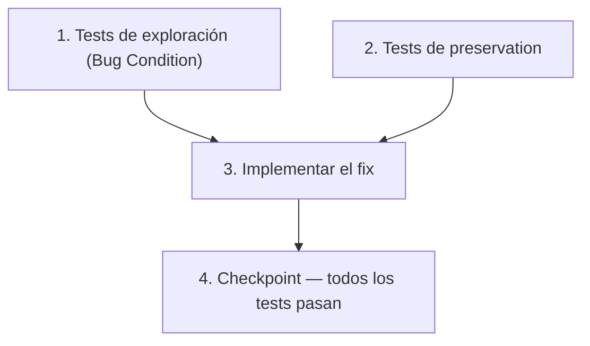

# Implementation Plan

## Overview

Este plan cubre la corrección de dos bugs de visualización en el POS:

1. **Bug 1 — Selector de proveedor:** El desplegable en `/dashboard/provider-invoice` muestra `name` en lugar de `description`. Requiere dos cambios coordinados: incluir `description` en la proyección del endpoint `GET /api/providers?minimal=1`, y actualizar el componente para renderizar `description` (con fallback "sin descripción").

2. **Bug 2 — Campo de descuento visible para no-admins:** El campo "% Descuento" y el resumen "Total con descuento" en el modal de pago de `/dashboard/saleTable` son visibles para todos los roles. El fix envuelve ambos bloques JSX con una guarda `getRole(session) === ROLE_ADMIN`.

El plan sigue la metodología exploración → preservation → implementación → validación en 4 tareas principales.

---

## Task Dependency Graph



```json
{
  "waves": [
    { "wave": 1, "tasks": ["1", "2"] },
    { "wave": 2, "tasks": ["3"] },
    { "wave": 3, "tasks": ["4"] }
  ]
}
```

> Las tareas 1 y 2 son independientes entre sí y pueden ejecutarse en paralelo. La tarea 3 requiere que ambas estén completas. La tarea 4 es el checkpoint final.

---

## Tasks

- [x] 1. Escribir tests de exploración de condición de bug (ANTES del fix)
  - **Property 1: Bug Condition** - Selector muestra `name` en lugar de `description`; campo descuento visible para no-admins
  - **CRITICAL**: Estos tests DEBEN FALLAR en el código sin fix — el fallo confirma que el bug existe
  - **DO NOT attempt to fix the tests or the code when they fail**
  - **NOTE**: Los tests codifican el comportamiento esperado — validarán el fix cuando pasen tras la implementación
  - **GOAL**: Evidenciar contraejemplos que demuestran ambos bugs
  - **Scoped PBT Approach**: Acotar cada propiedad al dominio concreto de entradas afectadas para reproducibilidad determinista
  - **Test 1.1 — Proyección del endpoint (Bug 1)**
    - Llamar `GET /api/providers?minimal=1` con el código sin fix
    - Verificar que el objeto retornado NO contiene el campo `description` → confirma causa raíz del endpoint
    - `isBugCondition_Bug1`: el endpoint proyecta `{ id, name }` y omite `description`
    - **EXPECTED OUTCOME**: Test FALLA porque `description` no está en la respuesta (eso confirma el bug)
  - **Test 1.2 — Renderizado del selector (Bug 1)**
    - Renderizar `ProviderInvoicePage` con proveedores mockeados `[{ id: 1, name: "Distribuidora XYZ", description: "Carnes y embutidos" }, { id: 2, name: "Lácteos del Valle", description: null }]`
    - Asegurar que el texto visible del `<option>` sea `description || "sin descripción"` y NO `name`
    - `isBugCondition_Bug1`: `textoMostrado(p) === p.name AND textoMostrado(p) !== (p.description ?? "sin descripción")`
    - Documentar contraejemplo encontrado: "option[value=1] muestra 'Distribuidora XYZ' en lugar de 'Carnes y embutidos'"
    - **EXPECTED OUTCOME**: Test FALLA porque el componente usa `{p.name}`
  - **Test 1.3 — Visibilidad del campo descuento para rol empleado (Bug 2)**
    - Renderizar `DailySales` con sesión de rol empleado (`userRole !== ROLE_ADMIN`) y `isAboutToBePaid = true`
    - Verificar que el campo "% Descuento" NO está presente en el DOM
    - `isBugCondition_Bug2`: `isAboutToBePaid === true AND userRole !== ROLE_ADMIN AND campoDescuentoVisible() === true`
    - Documentar contraejemplo: "El input '% Descuento' es visible para rol empleado cuando isAboutToBePaid=true"
    - **EXPECTED OUTCOME**: Test FALLA porque el bloque JSX no tiene guarda de rol
  - **Test 1.4 — Visibilidad del resumen "Total con descuento" para rol empleado (Bug 2)**
    - Mismo setup anterior con `discountPercentInput = "10"`
    - Verificar que el texto "Total con descuento" NO aparece en el DOM para rol empleado
    - **EXPECTED OUTCOME**: Test FALLA porque el `<p>` condicional solo comprueba `discountPct > 0`, no el rol
  - Marcar tarea como completa cuando los tests estén escritos, ejecutados y los fallos documentados
  - _Requirements: 1.1, 1.2, 1.3, 1.4, 1.5_

- [x] 2. Escribir tests de preservation (ANTES del fix)
  - **Property 2: Preservation** - `value` del `<option>` siempre es `p.id`; admin sigue viendo el campo; cálculo de total sin cambios
  - **IMPORTANT**: Seguir metodología observation-first: observar el código sin fix con inputs no-buggy, luego codificar ese comportamiento como property
  - **Test 2.1 — `value` del `<option>` no cambia (Property-Based)**
    - Generar arrays de proveedores con combinaciones aleatorias de `description` (string no vacío, `null`, `""`, `undefined`)
    - Observar en código sin fix: el `value` de cada `<option>` es siempre `p.id`
    - Escribir propiedad: para todo proveedor `p`, `option.value === String(p.id)` independientemente de `name` y `description`
    - `¬isBugCondition_Bug1`: el `value` no forma parte de la condición de bug, así que siempre se preserva
    - **EXPECTED OUTCOME**: Test PASA en código sin fix (confirma comportamiento de base)
  - **Test 2.2 — Admin sigue viendo el campo "% Descuento" (Bug 2 — preservation)**
    - Renderizar `DailySales` con sesión de administrador (`getRole(session) === ROLE_ADMIN`) y `isAboutToBePaid = true`
    - Verificar que el campo "% Descuento" está presente en el DOM
    - `¬isBugCondition_Bug2` para admin: la condición de bug requiere `userRole !== ROLE_ADMIN`
    - **EXPECTED OUTCOME**: Test PASA en código sin fix (el admin siempre ve el campo)
  - **Test 2.3 — Cálculo del total sin cambios para no-admin (Property-Based)**
    - Con `discountPercentInput = "0"` y cualquier `subtotal > 0`, verificar que `finalTotal === subtotal`
    - Esta invariante se cumple antes y después del fix porque el campo no es editable para no-admins
    - **EXPECTED OUTCOME**: Test PASA en código sin fix
  - **Test 2.4 — Tipo de pago y calculadora de vuelto visibles para todos los roles**
    - Verificar que el selector de tipo de pago (`efectivo`, `transferencia`, `mixto`) y la sección de vuelto siguen presentes en el DOM para rol empleado con `isAboutToBePaid = true`
    - **EXPECTED OUTCOME**: Test PASA en código sin fix (esos controles no están condicionados por rol)
  - **Test 2.5 — Registro de factura correcto (Bug 1 — preservation)**
    - Verificar que al seleccionar un proveedor y enviar el formulario, el `providerId` en el payload POST a `/api/provider-movements` es `p.id`
    - **EXPECTED OUTCOME**: Test PASA en código sin fix (el `value={p.id}` no cambia con el bug)
  - Marcar tarea como completa cuando los tests estén escritos, ejecutados y pasen en el código sin fix
  - _Requirements: 3.1, 3.2, 3.3, 3.4, 3.5, 3.6_

- [x] 3. Fix — Selector de proveedor y campo de descuento por rol

  - [x] 3.1 Agregar `description` a la proyección del endpoint `GET /api/providers?minimal=1`
    - Editar `src/app/api/providers/route.js`
    - En el handler `GET`, rama `if (searchParams.get("minimal") === "1")`, cambiar:
      ```js
      select: { id: true, name: true }
      ```
      por:
      ```js
      select: { id: true, name: true, description: true }
      ```
    - El campo `description` es nullable (`String?`) en el schema de Prisma — no requiere migración
    - No se expone `accountNumber` ni ningún campo sensible adicional
    - _Bug_Condition: `GET /api/providers?minimal=1` retorna objetos sin `description`_
    - _Expected_Behavior: la respuesta incluye `description` (puede ser `null`) para cada proveedor_
    - _Preservation: `accountNumber` y demás campos sensibles continúan ausentes de la respuesta_
    - _Requirements: 2.1, 2.2, 2.3, 3.2_

  - [x] 3.2 Cambiar el texto del `<option>` de `p.name` a `p.description || "sin descripción"`
    - Editar `src/app/dashboard/provider-invoice/page.jsx`
    - Localizar el bloque de renderizado del `<Select>` de proveedores y reemplazar:
      ```jsx
      <option key={p.id} value={p.id}>
        {p.name}
      </option>
      ```
      por:
      ```jsx
      <option key={p.id} value={p.id}>
        {p.description ? p.description : "sin descripción"}
      </option>
      ```
    - El `value={p.id}` permanece inalterado — el `providerId` enviado a `/api/provider-movements` no cambia
    - La condición cubre `null`, `undefined` y `""` (descripción vacía se trata como ausente)
    - _Bug_Condition: `isBugCondition_Bug1` — `textoMostrado(p) === p.name`_
    - _Expected_Behavior: `textoMostrado(p) === (p.description || "sin descripción")`_
    - _Preservation: `value` del `<option>` sigue siendo `p.id`_
    - _Requirements: 2.1, 2.2, 2.3, 3.1_

  - [x] 3.3 Envolver el campo "% Descuento" con guarda de rol `ROLE_ADMIN`
    - Editar `src/app/dashboard/saleTable/page.js`
    - Dentro del bloque `{isAboutToBePaid && (...)}`, en el `<div className="flex flex-wrap gap-4 items-end">`, envolver el sub-bloque del campo de descuento:
      ```jsx
      {getRole(session) === ROLE_ADMIN && (
        <div>
          <label className="block text-xs text-content-muted mb-1">% Descuento</label>
          <input
            type="number"
            min="0"
            max="100"
            value={discountPercentInput}
            onChange={(e) => setDiscountPercentInput(e.target.value)}
            className="bg-surface-hover border border-border text-content px-3 py-2 rounded-md w-24 text-right"
          />
        </div>
      )}
      ```
    - `getRole` y `ROLE_ADMIN` ya están importados en el archivo — no se requiere ningún import nuevo
    - _Bug_Condition: `isBugCondition_Bug2` — `isAboutToBePaid === true AND userRole !== ROLE_ADMIN AND campoDescuentoVisible() === true`_
    - _Expected_Behavior: el campo "% Descuento" solo se renderiza cuando `getRole(session) === ROLE_ADMIN`_
    - _Preservation: el campo sigue visible y funcional para el administrador; los demás controles de pago no se tocan_
    - _Requirements: 2.4, 2.5, 3.4, 3.5, 3.6_

  - [x] 3.4 Envolver el resumen "Total con descuento" con guarda de rol `ROLE_ADMIN`
    - Editar `src/app/dashboard/saleTable/page.js`
    - En el bloque de "Verificación visual antes de guardar", reemplazar:
      ```jsx
      {discountPct > 0 && (
        <p>
          Total con descuento ({discountPct}%):{" "}
          ...
        </p>
      )}
      ```
      por:
      ```jsx
      {getRole(session) === ROLE_ADMIN && discountPct > 0 && (
        <p>
          Total con descuento ({discountPct}%):{" "}
          ...
        </p>
      )}
      ```
    - La condición `discountPct > 0` se mantiene — el resumen solo aparece cuando hay descuento activo Y el usuario es admin
    - `handleConfirmPayment`, `finalTotal`, `discountPct` y todo el estado no se modifican
    - _Bug_Condition: `isBugCondition_Bug2` — el resumen "Total con descuento" visible para `userRole !== ROLE_ADMIN`_
    - _Expected_Behavior: el resumen solo se renderiza cuando `getRole(session) === ROLE_ADMIN AND discountPct > 0`_
    - _Preservation: el cálculo de `finalTotal` es idéntico para todos los roles; el admin sigue viendo el resumen_
    - _Requirements: 2.4, 2.5, 3.4, 3.5_

  - [x] 3.5 Verificar que los tests de exploración (Property 1) ahora pasan
    - **Property 1: Expected Behavior** - Selector muestra `description`; campo descuento oculto para no-admins
    - **IMPORTANT**: Re-ejecutar los MISMOS tests de la tarea 1 — NO escribir tests nuevos
    - Los tests de la tarea 1 codifican el comportamiento esperado; cuando pasen, el fix es correcto
    - Re-ejecutar Test 1.1: `GET /api/providers?minimal=1` ahora retorna `description` → debe PASAR
    - Re-ejecutar Test 1.2: `<option>` muestra `description || "sin descripción"` → debe PASAR
    - Re-ejecutar Test 1.3: campo "% Descuento" NO está en el DOM para rol empleado → debe PASAR
    - Re-ejecutar Test 1.4: resumen "Total con descuento" NO está en el DOM para rol empleado → debe PASAR
    - **EXPECTED OUTCOME**: Todos los tests PASAN (confirma que ambos bugs están corregidos)
    - _Requirements: 2.1, 2.2, 2.3, 2.4, 2.5_

  - [x] 3.6 Verificar que los tests de preservation (Property 2) siguen pasando
    - **Property 2: Preservation** - Sin regresiones en comportamientos existentes
    - **IMPORTANT**: Re-ejecutar los MISMOS tests de la tarea 2 — NO escribir tests nuevos
    - Re-ejecutar Test 2.1: `value` del `<option>` sigue siendo `p.id` → debe PASAR
    - Re-ejecutar Test 2.2: admin sigue viendo el campo "% Descuento" → debe PASAR
    - Re-ejecutar Test 2.3: `finalTotal === subtotal` para no-admin con `discountPercentInput = "0"` → debe PASAR
    - Re-ejecutar Test 2.4: tipo de pago y calculadora de vuelto visibles para todos los roles → debe PASAR
    - Re-ejecutar Test 2.5: `providerId` en el payload POST sigue siendo `p.id` → debe PASAR
    - **EXPECTED OUTCOME**: Todos los tests PASAN (confirma que no hay regresiones)

- [x] 4. Checkpoint — Todos los tests deben pasar
  - Ejecutar la suite completa de tests del proyecto
  - Confirmar que los 4 tests de exploración pasan (fix checking)
  - Confirmar que los 5 tests de preservation siguen pasando (regression checking)
  - Revisar manualmente en el navegador:
    - Perfil empleado → `/dashboard/provider-invoice` → desplegable muestra `description` (o "sin descripción")
    - Perfil empleado → `/dashboard/saleTable` → modal de pago de venta "en mesa" NO muestra "% Descuento"
    - Perfil administrador → `/dashboard/saleTable` → modal de pago SÍ muestra "% Descuento" y resumen con descuento
  - Consultar si surgen dudas antes de cerrar el spec

---

## Notes

- **Archivos afectados** (3 en total):
  1. `src/app/api/providers/route.js` — agregar `description: true` a la proyección `select` de la rama `minimal=1`
  2. `src/app/dashboard/provider-invoice/page.jsx` — cambiar `{p.name}` por `{p.description ? p.description : "sin descripción"}` en el `<option>`
  3. `src/app/dashboard/saleTable/page.js` — envolver campo "% Descuento" y resumen "Total con descuento" con `getRole(session) === ROLE_ADMIN`

- **No se requieren migraciones de base de datos**: el campo `description` (`String?`) ya existe en el modelo `Provider` del schema de Prisma. El fix solo ajusta qué campos se incluyen en la proyección de la query.

- **No se requieren nuevos imports**: `getRole` y `ROLE_ADMIN` ya están importados en `saleTable/page.js`. No se introducen dependencias nuevas en ningún archivo.

- **Alcance mínimo**: ningún cambio toca lógica de negocio, flujos de pago, cálculos de totales ni APIs más allá de lo estrictamente necesario.
