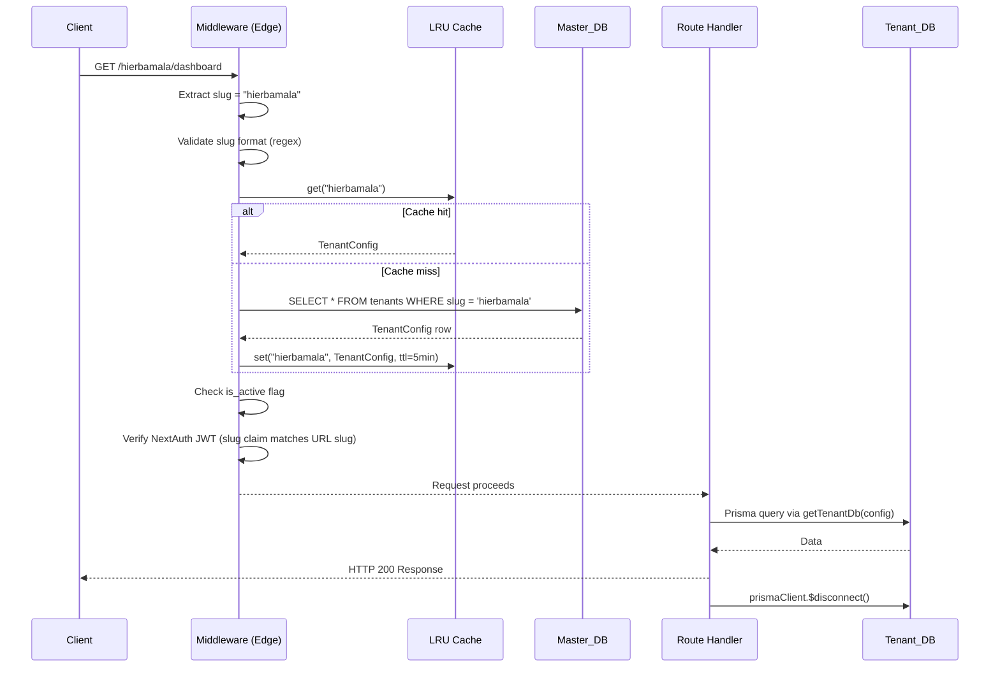
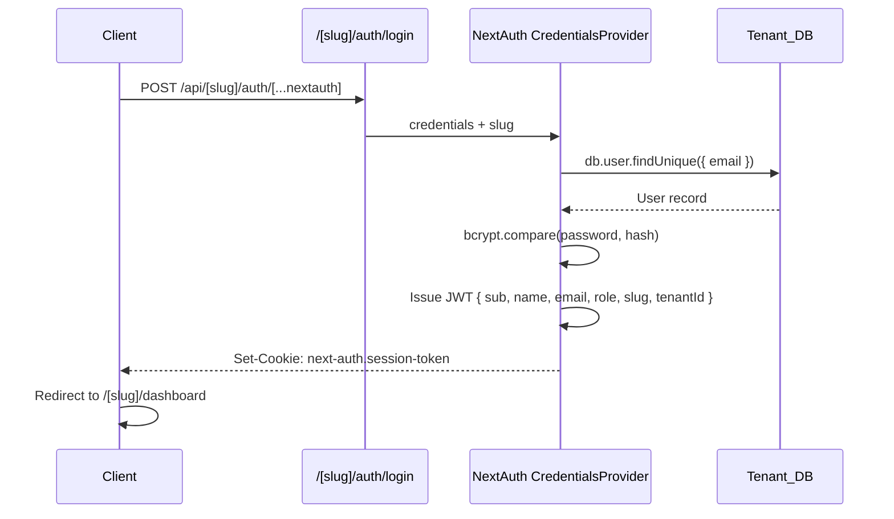

# Design Document

## Overview

This document describes the technical design for transforming the POS application from a single-tenant deployment model (one Vercel deployment per client, configured entirely via `.env` variables) into a **multi-tenant SaaS architecture** where a single Vercel deployment serves an unlimited number of clients.

Each client (tenant) is identified by a **slug** — the first path segment of every URL. A centralized **Master_DB** (MySQL) stores the configuration for every tenant. Each tenant retains its own isolated MySQL **Tenant_DB**. An in-process LRU cache avoids querying Master_DB on every request. NextAuth sessions carry the tenant slug as a claim so that cross-tenant session reuse is rejected at the middleware layer.

### Key Design Decisions

| Decision | Choice | Rationale |
|---|---|---|
| Tenant identification | URL slug (`/[slug]/...`) | No subdomain DNS changes needed on Vercel free tier; slug in URL is unambiguous |
| Tenant isolation | Separate MySQL DB per tenant | Strongest data isolation; Prisma already supports dynamic `datasource` URLs |
| Config storage | Master_DB MySQL table | Single source of truth; avoids `n` env-var deployments |
| Caching | In-process LRU (no Redis) | Requirement 4.5 forbids external cache; `lru-cache` npm package is battle-tested |
| Prisma client strategy | One client per request, disconnected after | Avoids connection-pool exhaustion in serverless; Next.js Edge routes get short-lived connections |
| Admin panel auth | `role = SUPER_ADMIN` claim in NextAuth JWT | Reuses existing NextAuth; no second auth system required |

---

## Architecture

### High-Level Architecture

```mermaid
graph TB
    Browser["Browser / PWA Client"]
    Vercel["Vercel Deployment\n(single Next.js app)"]
    MW["Next.js Middleware\n(Edge Runtime)"]
    Cache["In-Process LRU Cache\n(max 500, TTL 5 min)"]
    MasterDB[("Master_DB\nMySQL\n193.203.166.236\nu199394756_master_pos")]
    TenantA[("Tenant_DB A\nhierbamala")]
    TenantB[("Tenant_DB B\nraicescampesinas")]
    TenantN[("Tenant_DB N\n...")]

    Browser -->|HTTPS request /slug/...| Vercel
    Vercel --> MW
    MW -->|slug lookup| Cache
    Cache -->|cache miss| MasterDB
    MasterDB -->|TenantConfig| Cache
    Cache -->|TenantConfig| MW
    MW -->|allowed| Vercel
    Vercel -->|getTenantDb(slug)| TenantA
    Vercel -->|getTenantDb(slug)| TenantB
    Vercel -->|getTenantDb(slug)| TenantN
```

### Request Lifecycle



### Authentication Flow



---

## Components and Interfaces

### New File/Folder Structure

The existing codebase is reorganized under a `[slug]` dynamic segment. Files that do not change structurally are noted with `(unchanged)`.

```
src/
  app/
    page.jsx                          ← Landing page (no tenant data) (unchanged)
    layout.jsx                        ← Root layout, NO tenant metadata here
    globals.css                       (unchanged)
    Providers.jsx                     (unchanged)

    [slug]/                           ← NEW: all tenant-scoped pages live here
      layout.jsx                      ← Fetches TenantConfig server-side, provides TenantContext
      manifest.json/                  ← Dynamic per-tenant manifest route
        route.js
      auth/
        login/
          page.jsx
      dashboard/
        page.jsx
        alerts/
        ingredients/
        products/
        providers/
        sales/
        salesDaily/
        saleTable/
        openChecklist/
        IngredientInventory/
        ProductInventory/
        provider-invoice/
      pago/

    admin/                            ← NEW: Super_Admin panel (no slug prefix)
      layout.jsx                      ← Verifies SUPER_ADMIN role
      tenants/
        page.jsx                      ← Tenant list
        new/
          page.jsx                    ← Create tenant form
        [id]/
          page.jsx                    ← Edit tenant form

    not-found-tenant/                 ← NEW: dedicated tenant-not-found page
      page.jsx

  app/
    api/
      [slug]/                         ← NEW: all tenant-scoped API routes
        auth/
          [...nextauth]/
            route.js                  ← NextAuth with slug-aware CredentialsProvider
        alerts/
        business/
        game/
        ingredient/
        product/
        products/
        provider-movements/
        providers/
        sale/
        upload/
        subscribe/
        send-notifications/
        print/
        print-ip/
        print-ticket/
        ...
      admin/                          ← NEW: admin API routes (Super_Admin only)
        tenants/
          route.js                    ← GET (list), POST (create)
          [id]/
            route.js                  ← GET, PUT, DELETE

  libs/
    db.js                             ← REPLACED: now exports masterDb singleton
    tenantDb.js                       ← NEW: getTenantDb(tenantConfig) factory
    tenantCache.js                    ← NEW: LRU cache module
    tenantConfig.js                   ← NEW: resolveTenantConfig(slug) helper
    apiClient.js                      (unchanged)
    apiResponse.js                    (unchanged)
    roles.js                          ← EXTENDED: adds ROLE_SUPER_ADMIN constant

  middleware.js                       ← REPLACED: slug-aware + tenant-auth guard

  services/                           (unchanged — pure business logic, no db imports)

scripts/
  migrate-tenants.js                  ← NEW: one-shot migration script
```

### Module Interfaces

#### `src/libs/tenantCache.js`

```js
// In-memory LRU cache backed by the 'lru-cache' npm package.
// Max 500 entries, TTL 5 minutes per entry.

/**
 * @param {string} slug
 * @returns {TenantConfig | undefined}
 */
export function getCachedTenant(slug) { ... }

/**
 * @param {string} slug
 * @param {TenantConfig} config
 */
export function setCachedTenant(slug, config) { ... }

/**
 * @param {string} slug
 */
export function invalidateCachedTenant(slug) { ... }
```

#### `src/libs/tenantConfig.js`

```js
/**
 * Resolves TenantConfig for a slug.
 * 1. Checks LRU cache
 * 2. On miss: queries Master_DB via masterDb
 * 3. Returns null if slug not found or is_active = false
 *
 * @param {string} slug
 * @returns {Promise<TenantConfig | null>}
 */
export async function resolveTenantConfig(slug) { ... }
```

#### `src/libs/tenantDb.js`

```js
/**
 * Creates a new PrismaClient connected to the tenant's DATABASE_URL.
 * Caller is responsible for calling $disconnect() after the request.
 *
 * @param {TenantConfig} tenantConfig
 * @returns {PrismaClient}
 */
export function getTenantDb(tenantConfig) {
  return new PrismaClient({
    datasources: { db: { url: tenantConfig.database_url } },
  });
}
```

#### `src/libs/db.js` (repurposed as Master DB client)

```js
// Exports a singleton PrismaClient connected to MASTER_DATABASE_URL.
// This is the ONLY place masterDb is instantiated.
import { PrismaClient } from '@prisma/master-client'; // generated from schema.master.prisma

const globalForPrisma = globalThis;
export const masterDb = globalForPrisma.masterDb ?? new PrismaClient();
if (process.env.NODE_ENV !== 'production') globalForPrisma.masterDb = masterDb;
export default masterDb;
```

#### `src/middleware.js` (redesigned)

```js
export async function middleware(req) {
  const { pathname } = req.nextUrl;

  // 1. Pass-through for static assets and Next.js internals
  // 2. Admin routes: verify SUPER_ADMIN JWT claim, no slug processing
  // 3. Root path (/): serve landing page, no slug processing
  // 4. Extract first path segment as candidate slug
  // 5. Validate slug format (regex: /^[a-z0-9-]{2,63}$/)
  //    → invalid format: return 400
  // 6. resolveTenantConfig(slug)
  //    → null: redirect to /not-found-tenant with 302
  // 7. Verify NextAuth JWT:
  //    a. Signature valid
  //    b. Not expired
  //    c. token.slug === slug from URL
  //    → mismatch or missing: redirect to /[slug]/auth/login
  // 8. Public paths within a valid slug (/[slug]/auth/login): allow unauthenticated
  // 9. All other slug-scoped paths: require valid JWT
}

export const config = {
  matcher: ['/((?!_next/static|_next/image|favicon.ico|icons/).*)'],
};
```

---

## Data Models

### Master DB Prisma Schema (`prisma/schema.master.prisma`)

```prisma
generator client {
  provider = "prisma-client-js"
  output   = "../prisma/@prisma/master-client"
}

datasource db {
  provider = "mysql"
  url      = env("MASTER_DATABASE_URL")
}

model Tenant {
  id                    Int      @id @default(autoincrement())
  slug                  String   @unique @db.VarChar(63)
  name                  String
  database_url          String   @db.Text
  cloudinary_cloud_name String?
  cloudinary_api_key    String?
  cloudinary_api_secret String?  @db.Text
  app_name              String
  app_short_name        String?
  email                 String
  phone                 String?
  manifest_icon_192     String?  @db.Text
  manifest_icon_256     String?  @db.Text
  manifest_icon_512     String?  @db.Text
  white_logo_url        String?  @db.Text
  is_active             Boolean  @default(true)
  created_at            DateTime @default(now())
  updated_at            DateTime @updatedAt

  @@index([slug])
}
```

### Tenant DB Schema (`prisma/schema.prisma`)

The existing `schema.prisma` is **unchanged** for tenant databases. Each tenant's MySQL database contains all current models: `User`, `Sale`, `Product`, `Ingredient`, `Provider`, `Business`, `Game`, `Alert`, `Subscription`, etc.

### TenantConfig TypeScript Shape

```ts
// Inferred from the Tenant model — this is what flows through the cache
// and is attached to requests.
type TenantConfig = {
  id: number;
  slug: string;
  name: string;
  database_url: string;         // never sent to client
  cloudinary_cloud_name: string | null;
  cloudinary_api_key: string | null;
  cloudinary_api_secret: string | null;  // never sent to client
  app_name: string;
  app_short_name: string | null;
  email: string;
  phone: string | null;
  manifest_icon_192: string | null;
  manifest_icon_256: string | null;
  manifest_icon_512: string | null;
  white_logo_url: string | null;
  is_active: boolean;
  created_at: Date;
  updated_at: Date;
};

// Safe subset exposed to client components (no secrets)
type PublicTenantConfig = Omit<
  TenantConfig,
  'database_url' | 'cloudinary_api_key' | 'cloudinary_api_secret'
>;
```

### NextAuth JWT Payload Extension

```ts
// JWT token payload (stored in the signed cookie)
type TenantJWT = {
  sub: string;        // user id from Tenant_DB
  name: string;       // username
  email: string;
  role: number | null; // maps to existing roles.js (1 = admin, null = employee)
  slug: string;       // NEW: tenant slug claim — used by middleware for cross-tenant check
  iat: number;
  exp: number;
};
```

### LRU Cache Entry

```ts
type CacheEntry = {
  config: TenantConfig;
  // TTL managed by lru-cache; no manual timestamp needed
};
```

---

## Correctness Properties

*A property is a characteristic or behavior that should hold true across all valid executions of a system — essentially, a formal statement about what the system should do. Properties serve as the bridge between human-readable specifications and machine-verifiable correctness guarantees.*

### Property 1: Slug normalization is idempotent

*For any* string, normalizing it to lowercase and then normalizing the result again produces the same output as normalizing once — `normalize(normalize(s)) === normalize(s)` — and the result is always fully lowercase.

**Validates: Requirements 1.4**

### Property 2: Invalid slug format is always rejected

*For any* string that either contains characters outside `[a-z0-9-]`, has fewer than 2 characters, or has more than 63 characters, the slug validation function SHALL return `false` and no database query SHALL be attempted.

**Validates: Requirements 1.5**

### Property 3: Valid slug format is always accepted

*For any* string whose length is between 2 and 63 (inclusive) and that contains only lowercase ASCII letters, digits, and hyphens, the slug validation function SHALL return `true`.

**Validates: Requirements 1.1, 1.5**

### Property 4: Tenant isolation via per-config Prisma client

*For any* two TenantConfig objects A and B where `A.database_url ≠ B.database_url`, the clients produced by `getTenantDb(A)` and `getTenantDb(B)` SHALL have different datasource URLs — specifically, `getTenantDb(A).datasource.url === A.database_url` and `getTenantDb(B).datasource.url === B.database_url`. The two clients are never the same object reference.

**Validates: Requirements 2.1, 2.2, 2.3**

### Property 5: Tenant client is always disconnected after a request

*For any* route handler invocation — whether it resolves successfully or throws an error — the Prisma tenant client obtained via `getTenantDb` SHALL have `$disconnect()` called before the handler returns or re-throws.

**Validates: Requirements 2.5**

### Property 6: Cache round-trip within TTL

*For any* slug and TenantConfig, calling `setCachedTenant(slug, config)` followed immediately by `getCachedTenant(slug)` (before the TTL elapses) SHALL return an object equal to the original `config`.

**Validates: Requirements 4.2**

### Property 7: Cache TTL eviction

*For any* slug and TenantConfig inserted into the cache, once 300 000 ms or more have elapsed since insertion (using fake timers), `getCachedTenant(slug)` SHALL return `undefined`.

**Validates: Requirements 4.1, 4.3**

### Property 8: Cache invalidation leaves no stale entry

*For any* slug, calling `invalidateCachedTenant(slug)` after any number of `setCachedTenant(slug, config)` calls SHALL result in `getCachedTenant(slug)` returning `undefined`, regardless of how recently the entry was set or how many times it was updated.

**Validates: Requirements 4.4, 7.6, 7.7**

### Property 9: Session slug claim must match URL slug

*For any* NextAuth JWT whose `slug` field equals slug S, and *for any* URL whose first path segment is slug T where `T !== S`, the middleware claim-check function SHALL return `false` (reject), and the request SHALL NOT proceed to the route handler.

**Validates: Requirements 5.4, 6.3, 6.4**

### Property 10: Public config never exposes secrets

*For any* TenantConfig object — regardless of what values the secret fields contain — converting it via `toPublicConfig(config)` SHALL produce an object that contains none of the keys `database_url`, `cloudinary_api_key`, or `cloudinary_api_secret`.

**Validates: Requirements 9.2**

### Property 11: Per-tenant manifest reflects TenantConfig

*For any* TenantConfig, the manifest object generated by the `/[slug]/manifest.json` route handler SHALL have `name === config.app_name` and icon `src` values equal to `config.manifest_icon_192`, `config.manifest_icon_256`, and `config.manifest_icon_512` respectively.

**Validates: Requirements 9.4**

### Property 12: Secret field masking preserves last-4 suffix

*For any* non-empty string value stored in a secret field (`cloudinary_api_secret`, `database_url`, or any field ending in `_secret` or `_password`), the Admin_Panel display function SHALL render exactly `'********' + value.slice(-4)` and nothing else of the original value.

**Validates: Requirements 7.8**

### Property 13: Tenant creation validation rejects any invalid input

*For any* create-tenant form submission where the `slug` contains characters outside `[a-z0-9-]`, has length < 2 or > 63, already exists in the set of known slugs, or where any required field (`slug`, `app_name`, `email`, `database_url`) is absent or empty, the validation function SHALL return a non-null per-field error message and SHALL NOT persist any record.

**Validates: Requirements 7.4, 7.5**

### Property 14: Migration script idempotency

*For any* set of tenant slugs already present in Master_DB, running the migration script again SHALL result in no additional rows for those slugs — the total row count after the second run equals the row count after the first run — and SHALL log a warning for each skipped slug.

**Validates: Requirements 8.4**

### Property 15: Migration script does not mutate Tenant_DBs

*For any* tenant's Tenant_DB state before the migration script runs, the state of that Tenant_DB SHALL be identical after the migration script completes — the script inserts rows only into Master_DB and performs no writes, updates, or deletes on any Tenant_DB.

**Validates: Requirements 8.3**

### Property 16: Error page body contains no sensitive data

*For any* unknown or inactive tenant slug, the HTML body of the 404 error response SHALL NOT match patterns associated with sensitive data — specifically, it must not contain substrings matching `DATABASE_URL`, file-system paths (`/src/`, `\src\`), JavaScript stack-trace patterns (`at \w+\.(js|ts):\d+`), or Prisma error codes (`P\d{4}`).

**Validates: Requirements 10.2**

### Property 17: Invalid credentials produce a generic error message

*For any* combination of email and password that fails authentication in a Tenant_DB, the error response body SHALL contain only the fixed generic message (e.g., `"Credenciales inválidas"`) and SHALL NOT vary based on whether the email was not found or the password was wrong.

**Validates: Requirements 6.8**

---

## Error Handling

### Slug Resolution Errors

| Condition | HTTP Status | Response | Side Effect |
|---|---|---|---|
| Slug format invalid (chars/length) | 400 | Generic bad-request response | No DB query |
| Slug not found in Master_DB | 302 → `/not-found-tenant` (renders 404) | "Tenant no encontrado" page | Log slug + UTC timestamp |
| Tenant `is_active = false` | 302 → `/not-found-tenant` (renders 404) | Same page, no hint of existence | Log slug + UTC timestamp |
| Master_DB unreachable | 503 | Generic server error | Fatal log at startup |

### Tenant DB Connection Errors

| Condition | HTTP Status | Response | Side Effect |
|---|---|---|---|
| `database_url` missing in TenantConfig | 503 | "Servicio no disponible" | Log error with slug |
| DB connection refused / timeout | 503 | "Servicio no disponible" | Log error with slug and reason |
| Prisma `$disconnect()` failure | No change to response | — | Log warning, non-fatal |

### Authentication Errors

| Condition | HTTP Status | Response |
|---|---|---|
| No session token on protected route | 302 → `/[slug]/auth/login` | — |
| JWT signature invalid or expired | 302 → `/[slug]/auth/login` | — |
| JWT `slug` claim ≠ URL slug | 401 | "Unauthorized" |
| Valid token but tenant `is_active = false` | 302 → `/not-found-tenant` | — |
| Invalid credentials on login | 401 | Generic "invalid credentials" (no username/password hint) |
| Slug in login URL not found in Master_DB | 404 | — |

### Admin Panel Errors

| Condition | HTTP Status | Response |
|---|---|---|
| Non-Super_Admin accesses `/admin/tenants` | 403 | Redirect to error page |
| Duplicate slug on create | 422 | Per-field error: "slug ya existe" |
| Missing required field on create | 422 | Per-field error message |
| Tenant record not found on PUT/DELETE | 404 | "Tenant not found" |

### Error Propagation Rules

1. **Never expose** `database_url`, stack traces, internal file paths, or Prisma error details to the HTTP response body.
2. **Always log** the tenant slug and a UTC timestamp for every failed tenant resolution.
3. **Fail fast** at startup if `MASTER_DATABASE_URL` is absent — the application must not serve any request in a degraded state where Master_DB is unavailable.
4. **Disconnect** the Prisma tenant client in a `finally` block so connection leaks never accumulate across requests.

---

## Testing Strategy

### Overview

The multi-tenant architecture involves two distinct layers of logic:

1. **Pure business logic** — slug validation, config serialization, cache eviction, JWT claim checking, admin form validation. These are pure functions and ideal for **property-based testing**.
2. **Infrastructure and I/O integration** — Prisma queries against real MySQL, NextAuth cookie issuance, middleware execution. These require **integration tests** with 1–3 representative examples.

### Unit Tests (Example-Based)

These cover specific scenarios and error conditions.

- `tenantCache.js`: set/get/invalidate with frozen time; LRU eviction at capacity 500; TTL expiry with mocked `Date.now`.
- `tenantConfig.js`: returns `null` for inactive tenant; returns `null` for unknown slug; caches on first hit; returns cache on second hit.
- `tenantDb.js`: returned PrismaClient has correct `datasource.db.url`; two calls with different configs produce clients with different URLs.
- `middleware.js`: 400 for bad slug format; 302 for unknown slug; 401 for mismatched slug claim; 302 redirect to login for missing token; pass-through for `/`; pass-through for `/[slug]/auth/login`.
- Admin form validation: rejects duplicate slug; rejects missing required fields; rejects invalid slug chars.
- `PublicTenantConfig` serializer: strips secret fields.

### Property-Based Tests (Vitest + `fast-check`)

Property-based tests use [fast-check](https://fast-check.io/) — already compatible with the existing Vitest setup, no new test runner required. Each test runs a minimum of **100 iterations**.

Tag format used in comments: `Feature: multi-tenant-architecture, Property {N}: {property_text}`

#### Property 1 — Slug normalization is idempotent
- **Generator**: `fc.string()` (any string)
- **Assertion**: `normalize(normalize(s)) === normalize(s)` and result equals `s.toLowerCase()`
- **Tag**: `Feature: multi-tenant-architecture, Property 1: Slug normalization is idempotent`

#### Property 2 — Invalid slug format is always rejected
- **Generator**: strings that fail `/^[a-z0-9-]{2,63}$/` (bad chars, length < 2 or > 63)
- **Assertion**: `validateSlugFormat(s) === false`
- **Tag**: `Feature: multi-tenant-architecture, Property 2: Invalid slug format is always rejected`

#### Property 3 — Valid slug format is always accepted
- **Generator**: `fc.stringMatching(/^[a-z0-9-]{2,63}$/)`
- **Assertion**: `validateSlugFormat(s) === true`
- **Tag**: `Feature: multi-tenant-architecture, Property 3: Valid slug format is always accepted`

#### Property 4 — Tenant isolation via per-config Prisma client
- **Generator**: two `fc.record` objects each with a distinct `database_url` string
- **Assertion**: `getTenantDb(configA).datasource.url === configA.database_url` and `getTenantDb(configB).datasource.url === configB.database_url` and they are not equal
- **Tag**: `Feature: multi-tenant-architecture, Property 4: Tenant isolation via per-config Prisma client`

#### Property 5 — Tenant client is always disconnected after a request
- **Generator**: `fc.boolean()` (represents whether the handler throws or resolves)
- **Assertion**: mock `$disconnect` spy is called exactly once after each handler invocation regardless of success/error
- **Tag**: `Feature: multi-tenant-architecture, Property 5: Tenant client is always disconnected after a request`

#### Property 6 — Cache round-trip within TTL
- **Generator**: arbitrary slug string + arbitrary TenantConfig record
- **Assertion**: `setCachedTenant(slug, config)` then `getCachedTenant(slug)` returns an object deep-equal to `config`
- **Tag**: `Feature: multi-tenant-architecture, Property 6: Cache round-trip within TTL`

#### Property 7 — Cache TTL eviction
- **Generator**: arbitrary slug + TenantConfig; time advance ≥ 300 000 ms using `vi.useFakeTimers`
- **Assertion**: after advancing clock, `getCachedTenant(slug) === undefined`
- **Tag**: `Feature: multi-tenant-architecture, Property 7: Cache TTL eviction`

#### Property 8 — Cache invalidation leaves no stale entry
- **Generator**: arbitrary slug + TenantConfig; optional prior set calls
- **Assertion**: after `invalidateCachedTenant(slug)`, `getCachedTenant(slug) === undefined`
- **Tag**: `Feature: multi-tenant-architecture, Property 8: Cache invalidation leaves no stale entry`

#### Property 9 — Session slug claim must match URL slug
- **Generator**: two distinct slug strings A and B (using `fc.uniqueArray(fc.stringMatching(/^[a-z0-9-]{2,63}$/), { minLength: 2, maxLength: 2 })`)
- **Assertion**: `checkSlugClaim({ slug: A }, B) === false` for all A ≠ B
- **Tag**: `Feature: multi-tenant-architecture, Property 9: Session slug claim must match URL slug`

#### Property 10 — Public config never exposes secrets
- **Generator**: `fc.record` with all TenantConfig fields fully populated including secrets
- **Assertion**: `toPublicConfig(config)` does not contain keys `database_url`, `cloudinary_api_key`, or `cloudinary_api_secret`
- **Tag**: `Feature: multi-tenant-architecture, Property 10: Public config never exposes secrets`

#### Property 11 — Per-tenant manifest reflects TenantConfig
- **Generator**: arbitrary TenantConfig record with non-null `app_name` and `manifest_icon_*` values
- **Assertion**: manifest generated by the route handler has `name === config.app_name` and icon srcs equal to the config's `manifest_icon_*` fields
- **Tag**: `Feature: multi-tenant-architecture, Property 11: Per-tenant manifest reflects TenantConfig`

#### Property 12 — Secret field masking preserves last-4 suffix
- **Generator**: `fc.string({ minLength: 4 })` (secret field value)
- **Assertion**: `maskSecretField(value) === '********' + value.slice(-4)`
- **Tag**: `Feature: multi-tenant-architecture, Property 12: Secret field masking preserves last-4 suffix`

#### Property 13 — Tenant creation validation rejects any invalid input
- **Generator**: fc records with slugs containing bad chars, wrong length, or duplicates in existing set; or with missing required fields
- **Assertion**: `validateTenantCreateInput(input, existingSlugs)` returns a non-null error object
- **Tag**: `Feature: multi-tenant-architecture, Property 13: Tenant creation validation rejects any invalid input`

#### Property 14 — Migration script idempotency
- **Generator**: set of tenant records already in a mock Master_DB; same records fed to migration again
- **Assertion**: row count after second run === row count after first run (no duplicates); warning logged for each skipped slug
- **Tag**: `Feature: multi-tenant-architecture, Property 14: Migration script idempotency`

#### Property 15 — Migration script does not mutate Tenant_DBs
- **Generator**: arbitrary set of tenant configs; arbitrary initial Tenant_DB state captured before migration
- **Assertion**: all mock Tenant_DB write methods (`create`, `update`, `delete`, `upsert`) are never called during migration execution
- **Tag**: `Feature: multi-tenant-architecture, Property 15: Migration script does not mutate Tenant_DBs`

#### Property 16 — Error page body contains no sensitive data
- **Generator**: arbitrary slug strings not present in Master_DB
- **Assertion**: 404 response body does not match `/DATABASE_URL|\/src\/|\\src\\|at \w+\.(js|ts):\d+|P\d{4}/i`
- **Tag**: `Feature: multi-tenant-architecture, Property 16: Error page body contains no sensitive data`

#### Property 17 — Invalid credentials produce a generic error message
- **Generator**: arbitrary (email, password) pairs that fail Tenant_DB auth (mock returns null)
- **Assertion**: error response body equals the single fixed generic message, does not vary across different email/password inputs
- **Tag**: `Feature: multi-tenant-architecture, Property 17: Invalid credentials produce a generic error message`

### Integration Tests (Example-Based, 1–3 runs each)

- Middleware with real Next.js request objects against a seeded Master_DB test instance.
- NextAuth login for a valid tenant user in Tenant_DB → JWT contains correct `slug` claim.
- Admin panel API: `POST /api/admin/tenants` creates row in Master_DB; `PUT` invalidates cache.
- Per-tenant manifest route: `GET /hierbamala/manifest.json` returns `name` matching the tenant's `app_name`.
- Tenant-not-found page: `GET /nonexistent/dashboard` returns 404 with "Tenant no encontrado" text.
- Migration script: inserts `hierbamala` and `raicescampesinas` rows; second run logs warnings and inserts nothing new.
- Inactive tenant: `GET /hierbamala/dashboard` after setting `is_active = false` returns 404, no hint of tenant existence.

### Test File Locations

```
src/
  libs/
    tenantCache.spec.js        ← Unit + PBT (Properties 6, 7, 8)
    tenantDb.spec.js           ← Unit + PBT (Properties 4, 5)
    tenantConfig.spec.js       ← Unit tests (cache miss/hit, inactive tenant)
  middleware.spec.js           ← Unit + PBT (Properties 2, 3, 9)
  services/
    slugValidation.spec.js     ← PBT (Properties 1, 2, 3)
    publicConfig.spec.js       ← PBT (Properties 10, 12)
    manifestBuilder.spec.js    ← PBT (Property 11)
  app/
    api/admin/
      tenants.spec.js          ← Unit + PBT (Property 13) + Integration
    [slug]/
      manifest.spec.js         ← PBT (Property 11)
scripts/
  migrate-tenants.spec.js      ← PBT (Properties 14, 15) + Integration
  errorPage.spec.js            ← PBT (Property 16)
  auth.spec.js                 ← PBT (Property 17) + Integration
```
