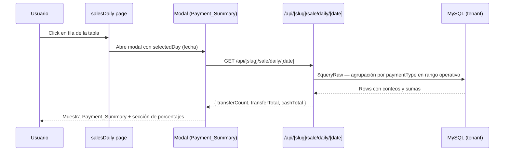

# Design Document

## Overview

Esta feature agrega un resumen de métodos de pago dentro de la modal de detalle diario en la página `salesDaily`. Para lograrlo se crea un nuevo endpoint `GET /api/[slug]/sale/daily/[date]` que calcula `transferCount`, `transferTotal` y `cashTotal` para un día operativo específico, y la modal lo consume al abrirse para mostrarlo antes de la sección de porcentajes.

El diseño sigue el patrón establecido en el proyecto: un route handler de Next.js que obtiene la conexión al tenant via `resolveTenantConfig` + `getTenantDb`, ejecuta una query SQL raw para respetar la lógica de zona horaria, y retorna JSON. En el frontend, la modal gestiona su propio estado de carga y error para la sección de pagos de forma independiente al resto del contenido.

## Architecture



### Estructura de archivos

```
src/app/api/[slug]/sale/daily/
  route.js                          ← existente (sin cambios)
  [date]/
    route.js                        ← NUEVO endpoint
    route.spec.js                   ← NUEVO tests unitarios

src/app/[slug]/dashboard/salesDaily/
  page.js                           ← modificado: añadir PaymentSummary a la Modal
```

## Components and Interfaces

### Backend: `GET /api/[slug]/sale/daily/[date]`

**Ruta:** `src/app/api/[slug]/sale/daily/[date]/route.js`

**Parámetros de ruta:**
- `slug` — identificador del tenant
- `date` — fecha en formato `YYYY-MM-DD`

**Respuesta exitosa (200):**
```json
{
  "transferCount": 5,
  "transferTotal": 120000,
  "cashTotal": 85000
}
```

**Respuestas de error:**
- `400` — `date` no coincide con el formato `YYYY-MM-DD`
- `404` — tenant no encontrado
- `500` — error interno

**Algoritmo de cálculo:**
1. Validar formato de `date` con regex `/^\d{4}-\d{2}-\d{2}$/`.
2. Construir rango del día operativo:
   - `start` = `YYYY-MM-DD 06:00:00` en hora Colombia (UTC-5) → convertido a UTC para la query: `YYYY-MM-DD 11:00:00 UTC`
   - `end` = `(YYYY-MM-DD + 1 día) 05:59:59` en hora Colombia → `YYYY-MM-DD 10:59:59 UTC` del día siguiente
3. Ejecutar query raw que aplica `CONVERT_TZ` y `CASE WHEN HOUR < 6` (misma lógica que `route.js` existente).
4. Agregar en JavaScript (post-query) los tres valores a partir de las rows individuales.

### Frontend: modificaciones en `salesDaily/page.js`

Se extrae un nuevo componente `PaymentSummary` dentro del mismo archivo:

```jsx
function PaymentSummary({ date, slug }) {
  // estado: loading | data | error
}
```

**Integración en la modal:**
```jsx
{showModal && selectedDay && (
  <Modal ...>
    <PaymentSummary date={selectedDay.date} slug={slug} />
    {/* sección de porcentajes existente */}
  </Modal>
)}
```

`PaymentSummary` realiza su propio `fetch` interno para que la sección de porcentajes nunca quede bloqueada, independientemente del estado del endpoint de detalle.

## Data Models

No se crean ni modifican tablas. El modelo `Sale` ya tiene los campos necesarios:

| Campo         | Tipo      | Descripción                                          |
|---------------|-----------|------------------------------------------------------|
| `paymentType` | `String?` | `"efectivo"`, `"transferencia"`, `"mixto"`, o `null` |
| `cashAmount`  | `Float?`  | Monto en efectivo para ventas de tipo `"mixto"`      |
| `totalAmount` | `Float`   | Monto total de la venta                              |
| `createdAt`   | `DateTime`| Timestamp en UTC — base para la lógica de zona horaria |

### Lógica de cálculo por `paymentType`

| `paymentType`    | Contribución a `transferTotal`  | Contribución a `cashTotal` | Cuenta en `transferCount` |
|------------------|---------------------------------|----------------------------|---------------------------|
| `"transferencia"`| `totalAmount`                   | `0`                        | Sí                        |
| `"mixto"`        | `totalAmount - cashAmount`      | `cashAmount`               | Sí                        |
| `"efectivo"`     | `0`                             | `totalAmount`              | No                        |
| `null` / otro    | `0`                             | `0`                        | No                        |

### Rango del día operativo

La lógica es consistente con el endpoint diario existente: ventas cuyo `HOUR(CONVERT_TZ(createdAt, '+00:00', '-05:00')) < 6` se asignan al día anterior.

El rango para una fecha operativa `D` se expresa en UTC como:

- `start_utc = D 11:00:00` (equivale a D 06:00 hora Colombia)
- `end_utc = (D+1) 10:59:59` (equivale a D+1 05:59:59 hora Colombia)

## Correctness Properties

*A property is a characteristic or behavior that should hold true across all valid executions of a system — essentially, a formal statement about what the system should do. Properties serve as the bridge between human-readable specifications and machine-verifiable correctness guarantees.*

### Property 1: Mixto split — transferencia es el complemento del efectivo

*Para cualquier* venta con `paymentType = "mixto"`, `cashAmount ≥ 0` y `totalAmount ≥ cashAmount`, la contribución a `transferTotal` debe ser exactamente `totalAmount - cashAmount` y la contribución a `cashTotal` debe ser exactamente `cashAmount`. La suma de ambas partes siempre debe ser igual a `totalAmount`.

**Validates: Requirements 1.3, 1.6**

### Property 2: Transferencia aporta su totalAmount completo al transferTotal

*Para cualquier* venta con `paymentType = "transferencia"` y `totalAmount ≥ 0`, la contribución a `transferTotal` es igual a `totalAmount` y la contribución a `cashTotal` es `0`.

**Validates: Requirements 1.4**

### Property 3: Efectivo aporta su totalAmount completo al cashTotal

*Para cualquier* venta con `paymentType = "efectivo"` y `totalAmount ≥ 0`, la contribución a `cashTotal` es igual a `totalAmount` y la contribución a `transferTotal` es `0`.

**Validates: Requirements 1.5**

### Property 4: Tipos de pago inválidos o null aportan cero a todos los totales

*Para cualquier* cadena que no sea `"efectivo"`, `"transferencia"` ni `"mixto"` (incluyendo `null`), la venta no debe modificar `transferCount`, `transferTotal` ni `cashTotal`.

**Validates: Requirements 1.7**

### Property 5: Cualquier string que no sea YYYY-MM-DD recibe respuesta 400

*Para cualquier* cadena que no coincida con el patrón `/^\d{4}-\d{2}-\d{2}$/`, el endpoint debe devolver un status `400`.

**Validates: Requirements 1.8**

### Property 6: Lógica del día operativo — hora < 6 pertenece al día anterior

*Para cualquier* datetime con `HOUR(CONVERT_TZ(ts, '+00:00', '-05:00')) < 6`, la fecha operativa asignada debe ser el día calendario anterior al de la venta en hora Colombia. Para cualquier datetime con hora ≥ 6, la fecha operativa es el mismo día calendario en hora Colombia.

**Validates: Requirements 1.10**

### Property 7: Formato de moneda aplicado a cualquier monto no negativo

*Para cualquier* número no negativo, `formatCurrency` debe devolver una cadena que comience con el símbolo de moneda colombiana y represente correctamente el valor sin decimales.

**Validates: Requirements 2.4, 2.5, 2.8**

## Error Handling

### Backend

| Condición                              | Status | Mensaje                                              |
|----------------------------------------|--------|------------------------------------------------------|
| Tenant no encontrado                   | 404    | `"Tenant no encontrado."`                            |
| `date` con formato inválido            | 400    | `"Formato de fecha inválido. Use YYYY-MM-DD."`       |
| Error de base de datos / inesperado    | 500    | `"Error al obtener detalle de pagos del día"`        |

El handler siempre llama `db.$disconnect()` en el bloque `finally`, consistente con los demás routes del proyecto.

### Frontend — `PaymentSummary`

- **Estado `loading`:** muestra un spinner / texto "Cargando pagos..." dentro de la sección, sin afectar la sección de porcentajes.
- **Estado `error`:** muestra un mensaje de error (`"No se pudo cargar el resumen de pagos."`) dentro de la sección `PaymentSummary`, dejando intacta la sección de porcentajes debajo.
- **Sin datos (todos cero):** se muestra normalmente con valores `0` y `$0`.

## Testing Strategy

El proyecto usa **Vitest** como runner de tests y **fast-check** (ya instalado como devDependency) como biblioteca de property-based testing.

### Tests unitarios — `route.spec.js`

Cubren casos concretos y condiciones de error con mocks de `resolveTenantConfig` y `getTenantDb`:

- `GET` con date válida y ventas en DB → retorna 200 con las tres claves.
- `GET` con date válida y sin ventas → retorna `{ transferCount: 0, transferTotal: 0, cashTotal: 0 }`.
- `GET` con date inválida → retorna 400.
- `GET` con tenant no encontrado → retorna 404.
- `GET` — error de DB → retorna 500.

### Tests de propiedad — `route.spec.js`

Implementados con **fast-check**, mínimo 100 iteraciones cada uno. Cada test referencia la propiedad del diseño en un comentario.

```js
// Feature: report-payment-method-summary, Property 1: Mixto split
fc.assert(fc.property(
  fc.float({ min: 0 }), // cashAmount
  fc.float({ min: 0 }), // extra (transfer part)
  (cash, extra) => {
    const totalAmount = cash + extra;
    const result = computeContribution({ paymentType: 'mixto', totalAmount, cashAmount: cash });
    return result.transfer === extra && result.cash === cash;
  }
), { numRuns: 100 });
```

```js
// Feature: report-payment-method-summary, Property 5: Invalid date → 400
fc.assert(fc.property(
  fc.string().filter(s => !/^\d{4}-\d{2}-\d{2}$/.test(s)),
  async (invalidDate) => {
    const res = await GET(makeRequest(invalidDate), PARAMS);
    return res.status === 400;
  }
), { numRuns: 100 });
```

```js
// Feature: report-payment-method-summary, Property 6: Operational day timezone logic
fc.assert(fc.property(
  fc.date(), // any datetime
  (dt) => {
    const colHour = getColombiaHour(dt);
    const opDay = computeOperationalDay(dt);
    const calDay = getColombiaCalendarDay(dt);
    if (colHour < 6) return opDay === subtractOneDay(calDay);
    return opDay === calDay;
  }
), { numRuns: 200 });
```

### Enfoque dual

- Los tests unitarios cubren la integración de los componentes y los casos de error.
- Los tests de propiedad verifican la lógica de cálculo puro (contribuciones por `paymentType`, validación del formato de fecha, lógica de zona horaria) con una amplia gama de inputs generados.
- Se evita escribir tests de propiedad para el comportamiento de la base de datos o la UI — esas partes se cubren con tests de ejemplo.
